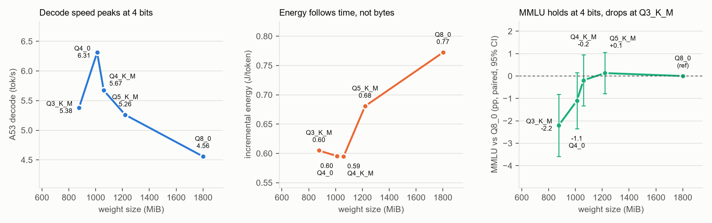

# Why fewer bits stop paying off: low-bit llama.cpp decode on a Cortex-A53

Measured with hardware counters and battery energy on a phone, then cross-checked on a GPU.

**Setup:** Sonim XP8800 (Snapdragon 630, 8× Cortex-A53, ARMv8.0, no dot-product instructions) ·
Qwen2.5-1.5B-Instruct in five GGUF quants · llama.cpp `23deec0`, 8 threads · cross-check on a
Tesla T4 (sm_75, `dp4a`).

**Full write-up:** [`a53/summary.md`](a53/summary.md) ([PDF](a53/summary.pdf), 3 pages).
[](.github/workflows/reproduce.yml)



1. **4 bits is the sweet spot on this phone.** Q4_0 decodes 38% faster than Q8_0 and uses 23%
   less energy per token, and Q4_K_M stays within noise of Q8_0 on MMLU. Going to Q3_K_M makes
   decode *slower* (−5% vs Q4_K_M) and costs accuracy: −2.2 ± 0.7 pp MMLU and +12.5% WikiText-2
   perplexity.
2. **Low-bit decode on an ARMv8.0 core is compute-bound, not memory-bound.** The dot kernels take
   82–85% of cycles, and K-quant unpacking adds instructions faster than fewer bytes save time.
   Only Q8_0 is limited by DRAM bandwidth, and energy follows time, not bytes.
3. **Because of that, speculative decoding cannot pay off here.** Checking 5 tokens in one batch
   costs 3.6× a single decode step, so a 0.5B draft model halves decode speed (0.5×, 54 paired
   runs), even at 66–72% acceptance.

## Result in one table

| Quant | Weights (MiB) | A53 decode (tok/s) | A53 energy (J/token) | WikiText-2 PPL (Δ vs Q8_0) | MMLU (Δ vs Q8_0, pp) | T4 decode, clock locked (tok/s) |
|---|---|---|---|---|---|---|
| Q3_K_M | 876 | 5.38 | 0.60 | 11.64 (+12.5%) | 33.9 (−2.2 ± 0.7) | 128.7 |
| **Q4_0** | 1011 | **6.31** | **0.60** | 10.87 (+5.1%) | 34.9 (−1.1 ± 0.6) | **153.3** |
| Q4_K_M | 1060 | 5.67 | 0.60 | 10.80 (+4.5%) | 35.9 (−0.2 ± 0.6) | 144.2 |
| Q5_K_M | 1220 | 5.26 | 0.68 | 10.46 (+1.1%) | 36.2 (+0.1 ± 0.5) | 136.2 |
| Q8_0 | 1801 | 4.56 | 0.77 | 10.34 | 36.0 | 103.7 |

Decode speeds are from clean runs (coefficient of variation < 2%). Energy is incremental battery
energy per decoded token with USB unplugged. Accuracy differences are paired against Q8_0 on the
same items (± one standard error). HellaSwag, WinoGrande and the method are in
[`accuracy/`](accuracy/).

## What the counters show

- **8 → 4 bits helps.** Q4_0 decodes 38% faster than Q8_0 and uses 23% less energy per token.
- **Below 4 bits, saved bytes stop buying time.** DRAM traffic per token falls with weight size,
  but instructions rise. Q3_K_M executes 16% more instructions than Q4_K_M, so it decodes 5% slower
  while reading 19% fewer bytes.
- **The extra work is unpacking.** `ggml_vec_dot_q*` kernels take 82–85% of cycles in every quant.
  Q3_K_M executes about 600 M more instructions per token than Q8_0, and essentially all of them
  are in the dot kernels.
- **Only Q8_0 is memory-bound.** Its dot kernel runs at IPC 0.29 and reaches 8.6 GB/s of DRAM
  bandwidth. The low-bit kernels run at IPC 0.51–0.59 and are limited by unpacking.
- **Energy follows time, not bytes.** Power is nearly flat at 2.8–3.2 W above idle, so the quant
  that finishes sooner costs less.
- **The T4 shows the same ordering.** Even with an int8 dot-product instruction, Q3_K_M is 10.7%
  slower than Q4_K_M. Its Q3_K matrix-vector kernel moves 95 GB/s against 200 GB/s for Q8_0. The
  three outcomes were written down before the run
  ([`t4/predictions_2026-10-30.md`](t4/predictions_2026-10-30.md)); the result matched C,
  "still unpacking-bound".

## Measurement hygiene that changed the answer

With 8 threads on 8 cores, one preempted thread leaves the other seven spinning in
`ggml_barrier`. That adds billions of instructions and made run-to-run spread larger than the gaps
between quants. Running with `--poll 0 -lm none`, pre-warming the page cache, and keeping only runs
with CV < 2% fixed it. It also overturned two findings of my earlier sweep: Q3_K_M is not faster
than Q4_K_M, and Q5_K_M is not the slowest quant (details in §4 of the write-up).

## Speculative decoding: compute-bound decode caps it at 1×

With a 0.5B Q4_K_M draft, speculative decoding of the 1.5B Q4_K_M target ran at half the baseline
speed. The test used 54 paired runs on the phone, `-t 4`, and outputs were identical across modes.

| Mode | Decode (tok/s, median) | Acceptance | vs baseline |
|---|---|---|---|
| baseline | 3.55 | – | 1.00× |
| fixed draft length 4 | 1.81 | 65.7% | 0.51× |
| adaptive draft length (EWMA of acceptance) | 1.77 | 71.8% | 0.50× |

The adaptive controller beats the fixed length on low-acceptance chat prompts (1.25×), but neither
mode can win on this core. Checking 5 tokens in one target batch takes 3.6× as long as decoding one
token, because decode here is compute-bound, not memory-bound. With the draft model's cost added,
the best possible speedup is 0.96–1.02× even when every draft token is accepted. Data, the cost
model and versions are in [`spec/`](spec/).

## Repository layout

| Path | Contents |
|---|---|
| [`a53/`](a53/) | Phone study: driver scripts, raw `simpleperf` and battery data, analysis scripts, results JSON, figures, write-up. [`a53/RUNS.md`](a53/RUNS.md) maps each data folder to the command that produced it |
| [`t4/`](t4/) | Colab notebook for the T4 cross-check, its generator script, pre-registered predictions (in Chinese, dated before the run) and the copied run output |
| [`accuracy/`](accuracy/) | WikiText-2 perplexity, HellaSwag, WinoGrande and MMLU for the five quants: run script, full logs, results with paired differences |
| [`spec/`](spec/) | Paired speculative-decoding runs on the phone (baseline, fixed, adaptive), batch verification timings, summary script |
| [`baseline/`](baseline/) | Earlier sweep (Oct 2026): perplexity script and text, desktop vs phone comparison, thermal log, speculative-decoding results, and a small benchmark harness with a 12-prompt regression set |

## Reproducing

**Models.** Download from
[Qwen/Qwen2.5-1.5B-Instruct-GGUF](https://huggingface.co/Qwen/Qwen2.5-1.5B-Instruct-GGUF) and
check:

```text
58cb5c05ecef48e82961f1a2be6544145ea26136f69dddda4bbbd092f0e4b993  qwen2.5-1.5b-instruct-q3_k_m.gguf
dcd819ff094852c38faba6873d8ff0c9d51eadb2844539e52042ae5d647bbfdb  qwen2.5-1.5b-instruct-q4_0.gguf
6a1a2eb6d15622bf3c96857206351ba97e1af16c30d7a74ee38970e434e9407e  qwen2.5-1.5b-instruct-q4_k_m.gguf
b46661073c18e5b56a41fa320975f866a00def1ff08feef4718e013258896f8c  qwen2.5-1.5b-instruct-q5_k_m.gguf
d7efb072e7724d25048a4fda0a3e10b04bdef5d06b1403a1c93bd9f1240a63c8  qwen2.5-1.5b-instruct-q8_0.gguf
```

**Android build** (NDK r27c, llama.cpp `23deec0`):

```sh
cmake -B build-android \
  -DCMAKE_TOOLCHAIN_FILE=$NDK/build/cmake/android.toolchain.cmake \
  -DANDROID_ABI=arm64-v8a -DANDROID_PLATFORM=android-29 \
  -DCMAKE_BUILD_TYPE=Release -DGGML_OPENMP=OFF -DLLAMA_CURL=OFF -DLLAMA_BUILD_SERVER=ON
cmake --build build-android --target llama-bench -j
```

Push `llama-bench`, the `lib*.so` files and the models to `/data/local/tmp/llm`, then follow
[`a53/RUNS.md`](a53/RUNS.md).

**Re-analysing without a phone.** All raw data is committed. The analysis scripts in `a53/` use
only the Python standard library, and rerunning them reproduces the committed JSON files exactly
(see `a53/RUNS.md`). CI reruns the A53, speculative-decoding and accuracy analyses on every push
and fails if any committed JSON changes. The overview figure comes from `a53/plot_overview.py`,
which needs matplotlib.

**T4.** Open [`t4/t4_crosscheck.ipynb`](t4/t4_crosscheck.ipynb) in Colab on a T4 runtime and run
all cells (about 30–40 minutes, mostly the build). The clock-locked runs and per-weight-type
kernel throughput are in [`t4/t4_run1_output.txt`](t4/t4_run1_output.txt).

## Limits

- One phone, one model. The phone study uses llama.cpp `23deec0`. Accuracy runs used `42916d8` on
  an x86 CPU, and the speculative runs used `42916d8` with the adaptive controller added. Accuracy
  does not depend on the device, but kernels differ slightly between builds.
- Task sets are modest: 400 HellaSwag tasks, the full WinoGrande and MMLU validation sets. Single
  2-SE differences out of the 16 comparisons should be read as suggestive.
- Energy is whole-phone at the battery terminal, not SoC rail power. Decode on battery ran 12–16%
  slower than on USB, which points to a lower frequency cap that I did not log.
- PMU events are ARM's generic names; I checked them only against the byte-count sanity check, not
  the A53 TRM.
- The T4 nsys pass is a single run that slows decode by 10–13%, so its kernel rates are relative.
- Next step: repeat on an ARMv8.2+ core with `sdot`/`udot`. My prediction is that the gap to Q8_0
  shrinks but Q3_K_M still loses to Q4_K_M.

## License

MIT, see [LICENSE](LICENSE). Model weights are not included; see the Hugging Face model page for
their license.

— Jiaxuan (Fred) Wen, October 2026
