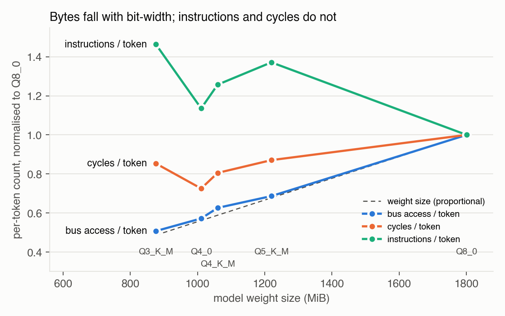
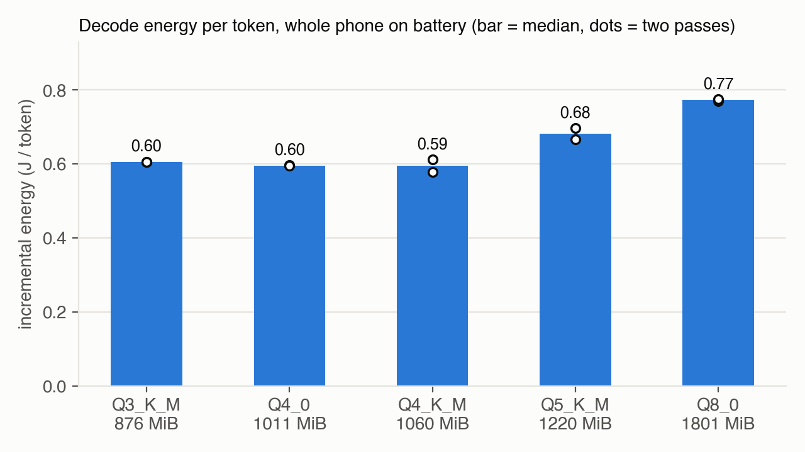

# Why fewer bits stop paying off on a Cortex-A53: counters and energy

Jiaxuan (Fred) Wen · Oct 2026 · Sonim XP8800 (Snapdragon 630, 8× Cortex-A53, ARMv8.0, no dot-product), Qwen2.5-1.5B-Instruct, llama.cpp `23deec0`, 8 threads, same five GGUF files as the earlier report (sha256 verified).

## 1. Problem

My earlier report found that Q3_K_M, Q4_0 and Q4_K_M all decoded at about 5.6 tok/s, so Q3_K_M was 17% smaller than Q4_K_M but only ~1% faster. It also found that Q5_K_M was the slowest quant. I attributed this to dequantization ("unpacking") cost, but that was an inference, not a measurement. Power (0.6–1.2 W) had also only been estimated while charging.

## 2. Method

**Counters (simpleperf stat, user-mode only).** Events ran in two groups of ≤4, so every counter had 100% coverage with no multiplexing: {cycles, instructions, L1D refill, L2D refill} and {cycles, instructions, bus access}. To isolate decode, I ran `llama-bench -p 0` at n = 32 and n = 160 (3 reps each). Per-token value = (X₁₆₀ − X₃₂) / (128 × 3). Every quant was measured twice, in forward and then reverse order.

**Attribution (simpleperf record).** I sampled cycles and instructions at 2 kHz during `-p 0 -n 64 -r 2` and grouped the symbols into three buckets:
- **dot kernels:** `ggml_vec_dot_q*`, which do dequantization plus multiply-add;
- **sync:** `ggml_graph_compute_thread`, into which `ggml_barrier` is inlined;
- **other:** everything else.

The recording also covers model load and warm-up, so per-token values are each bucket's sampled share multiplied by the Table 1 per-token total.

**Run hygiene (this mattered).** With 8 threads on 8 cores, one preempted thread leaves the other 7 spinning in `ggml_barrier`. This injects billions of instructions at IPC ≈ 1.1, even with `--poll 0`, and in my first pass it made the run-to-run spread larger than the gaps between quants. I therefore:
- ran with `--poll 0` and `-lm none`;
- pre-warmed the page cache;
- kept only runs whose tg coefficient of variation was < 2%.

Kept runs agree to within ±1.5%.

**Energy.** I unplugged USB and sampled the battery's `current_now × voltage_now` every 0.5 s while running `-p 0 -n 256 -r 3` with the same flags. The order was ABCDE then EDCBA, with 60 s idle before each run.
- E = (P_run − P_idle) / tg, where P_idle is the mean of the last 40 s of idle and P_run excludes the first 15 s of the run.
- The screen stayed on at fixed brightness, so display power cancels.
- There were no sampling gaps, and the phone reported "Discharging" throughout, from 100% to 90% battery.

## 3. Results

**Table 1 · Counters, USB power, per decoded token.** Weights are the tensor bytes llama-bench reports (`model_size`), the same measure in every table and figure. DRAM traffic is bus access × 16 B (the A53's 128-bit beat). Clean-run spread is within ±1.5% of the median; the widest is Q8_0 instructions, 1277–1313 M.

| Quant | Weights (MiB) | Instr. (M) | Cycles (M) | IPC | DRAM (GB) | DRAM BW (GB/s) | tg (tok/s) |
|---|---|---|---|---|---|---|---|
| Q3_K_M | 876 | 1906 | 2952 | 0.65 | 0.96 | 5.15 | 5.38 |
| Q4_0 | 1011 | 1479 | 2508 | 0.59 | 1.08 | 6.81 | 6.31 |
| Q4_K_M | 1060 | 1637 | 2784 | 0.59 | 1.18 | 6.70 | 5.67 |
| Q5_K_M | 1220 | 1786 | 3011 | 0.59 | 1.29 | 6.81 | 5.26 |
| Q8_0 | 1801 | 1302 | 3458 | 0.38 | 1.89 | 8.59 | 4.56 |

**Table 2 · Where the time and instructions go, per token.** Sampled shares × the Table 1 totals.

| Quant | Dot kernels: % of cycles | Dot kernels: instr. (M) | Dot kernels: IPC | Sync: % of cycles | Sync: instr. (M) |
|---|---|---|---|---|---|
| Q3_K_M | 84.0% | 1468 | 0.59 | 11.1% | 354 |
| Q4_0 | 82.7% | 1085 | 0.52 | 12.4% | 332 |
| Q4_K_M | 82.4% | 1176 | 0.51 | 12.5% | 380 |
| Q5_K_M | 82.5% | 1277 | 0.51 | 12.9% | 431 |
| Q8_0 | 84.9% | 857 | 0.29 | 10.5% | 363 |

**Table 3 · Energy, battery power.**

| Quant | tg on battery (tok/s) | ΔP (W) | J/token (incremental) | J/token (whole phone) |
|---|---|---|---|---|
| Q3_K_M | 4.61 | 2.79 | 0.60 | 0.78 |
| Q4_0 | 5.31 | 3.16 | 0.60 | 0.74 |
| Q4_K_M | 4.99 | 2.97 | 0.60 | 0.75 |
| Q5_K_M | 4.41 | 3.00 | 0.68 | 0.86 |
| Q8_0 | 3.89 | 3.00 | 0.77 | 0.96 |

## 4. Conclusion

**Fewer bits pay off down to about 4 bits, then stop.**

- **8 → 4 bits helps.** Q4_0 decodes 38% faster than Q8_0 and uses 23% less energy per token.
- **Below that, saved bytes no longer buy time.** DRAM traffic keeps falling with weight size: bus/Q8 is within 0.04 of size/Q8 for every quant. But instructions rise. Q3_K_M executes 16% more instructions than Q4_K_M and 6% more cycles, so it decodes 5% slower despite reading 19% fewer bytes.
- **The extra work is unpacking, measured directly.**
  - Dot kernels take 82–85% of cycles in every quant.
  - Sync stays roughly flat at 330–430 M instructions/token, and it runs at IPC ≈ 1.0–1.1, the signature of spinning.
  - Q3_K_M executes ~600 M more instructions per token than Q8_0, and essentially all of it is in the dot kernels (+611 M); sync is ~10 M lower.
- **Only Q8_0 is memory-bound.** Its dot kernel runs at IPC 0.29, against 0.51–0.59 for the low-bit kernels, and it reaches the highest DRAM bandwidth, 8.6 GB/s.
  - Q4_0, Q4_K_M and Q5_K_M reach 6.7–6.8 GB/s, and Q3_K_M only 5.2 GB/s. Without dot-product instructions, unpacking compute is their limit.
  - Q4_0 has the simplest block layout, the fewest kernel instructions and the highest speed.
- **The ordering is not A53-specific.** A Tesla T4 with an int8 dot-product instruction gives the same ranking, and its Q3_K kernel reads memory at less than half the rate of Q8_0's (§5). So the cost lies in unpacking the 3-bit layout, not only in the missing dot product.
- **Energy follows time, not bytes.** Incremental power is nearly flat at 2.8–3.2 W above a 0.78 W screen-on idle.
  - Q4_0, Q4_K_M and Q3_K_M tie at ≈0.60 J/token. Q3_K_M draws the least power, but its longer run time cancels the saving.
  - Q5_K_M costs 0.68 J/token and Q8_0 0.77 J/token.
  - Whole-phone energy is 0.74–0.96 J/token (median of two passes; single passes range 0.73–0.97).
  - My earlier 0.6–1.2 W estimate understated decode power by 2.5–5×.

**Three corrections to my earlier report.**

1. **Q3_K_M is not faster than Q4_K_M.** The earlier sweep had Q3_K_M, Q4_0 and Q4_K_M all at ~5.6 tok/s. Clean runs separate them: Q4_0 6.31 > Q4_K_M 5.67 > Q3_K_M 5.38. Single default-flag runs from my first pass (poll 50, mmap; CV ≤ 2.4%) give the same order, 6.40 > 5.99 > 5.69, so the change is not caused by my configuration. The earlier single-pass sweep was most likely compressed by the barrier-spin interference described above.
2. **Q5_K_M is not the slowest quant.** Clean runs give 5.26 tok/s (5.39 in a single default-flag run), faster than Q8_0's 4.56. The earlier 4.12 was most likely corrupted in the same way.
3. **My guess that Q5_K_M would execute the most instructions was wrong.** Q3_K_M does.

## 5. Cross-check on a GPU with dp4a

If the A53 result came only from the missing dot-product instruction, a processor that has one should decode in proportion to bytes. I tested this on a Tesla T4 (Turing, sm_75, `dp4a` int8 dot product, 320 GB/s, 70 W cap; driver 580.82.07). I used the same commit `23deec0` built with CUDA, the same five GGUF files (sha256 identical), all layers on the GPU, and `-p 0 -n 128 -r 5`, in forward then reverse order.

**Predictions, written down before the run (Oct 30).**
- **A, bandwidth-bound:** effective bandwidth within 15% across quants, and tg falling monotonically with file size. This would support the dot-product explanation.
- **B, overhead-bound:** tg within 10% across quants. The test would then be inconclusive at this model size.
- **C, still unpacking-bound:** A53 ordering, with Q3_K_M slower than Q4_K_M.

**Table 4 · Decode speed on the T4.** "Locked" fixes the SM clock at 1110 MHz. "Default" is the stock power-capped clock (SM 1180–1410 MHz). Effective bandwidth = weight size × tg.

| Quant | Weights (MiB) | T4 tg, locked | Eff. BW, locked (GB/s) | T4 tg, default | Speed vs Q8_0: T4 locked | Speed vs Q8_0: A53 |
|---|---|---|---|---|---|---|
| Q3_K_M | 876 | 128.7 | 118 | 131.9 | 1.24× | 1.18× |
| Q4_0 | 1011 | 153.3 | 163 | 166.1 | 1.48× | 1.38× |
| Q4_K_M | 1060 | 144.2 | 160 | 147.2 | 1.39× | 1.24× |
| Q5_K_M | 1220 | 136.2 | 174 | 137.0 | 1.31× | 1.15× |
| Q8_0 | 1801 | 103.7 | 196 | 108.7 | 1.00× | 1.00× |

The default-clock runs did not all pass my pre-registered check. After the reruns, CV was still 1.6–4.3% for Q3_K_M and 1.8–3.2% for Q4_K_M, because the 70 W cap makes the clock fluctuate. The locked runs are clean (two interleaved passes within 1%; CV ≤ 0.5% except one Q4_0 pass at 1.5%), so the verdict rests on them.

**Table 5 · Matrix-vector kernel throughput by weight type (nsys, 129 tokens).** Q3_K_M and Q4_K_M mix several types; each row pools that type's tensors. `token_embd` is excluded because it is only a row lookup.

| Weight type | Bits/weight | GB/s | G weights/s |
|---|---|---|---|
| Q3_K | 3.44 | 95 | 221 |
| Q4_K | 4.50 | 161–167 | 286–296 |
| Q6_K | 6.56 | 192–225 | 234–274 |
| Q8_0 | 8.50 | 200 | 188 |

**Verdict: C.**
- **B is ruled out.** With the clock locked, effective bandwidth varies 1.66× and tg 1.48× across quants. Under nsys the GPU is busy 92–94% of decode time, so launch gaps are small.
- **A is ruled out.** Q3_K_M is the second-slowest quant even here: 10.7% slower than Q4_K_M with the clock locked (10.4% at default clocks).
- **The cause is the Q3_K kernel.** It moves bytes at less than half the rate of Q8_0 (95 vs 200 GB/s). It also processes fewer weights per second than Q4_K (221 vs 286–296 G/s), even though each Q3_K weight is about one bit smaller.
- **The A53 pattern repeats.** Q4_0 is fastest, and fewer bits pay off down to 4 bits and then stop.
- **What this changes.** The hypothesis needs revising: `dp4a` makes the multiply-accumulate cheap, but not the unpacking. Q3_K stores each weight as 2 low bits plus 1 high bit in a separate mask, with 6-bit packed scales, so unpacking costs more than the bytes it saves. This test cannot tell whether that cost is intrinsic to the layout or comes from a less-tuned kernel.

## 6. Limits and next step

- All A53 results come from one device, one model and one llama.cpp commit.
- **Configuration.** The counter runs use `--poll 0` and no mmap. Q4_K_M runs at 5.67 tok/s here, against 5.59 in the earlier report.
- **No weight repacking.** The load logs show that all 339 weight tensors fall back from `CPU_REPACK` to plain CPU buffers with and without mmap, at identical buffer sizes. As expected without dot-product or i8mm, `-lm none` does not change the weight layout.
- **Sync is an upper bound.** It includes `ggml_graph_compute_thread`'s scheduling loop as well as the barrier. Symbol shares are sampled, and recording slows tg by ~4–5%.
- **PMU events.** These are ARM's generic event names; I did not check their exact semantics against the A53 TRM beyond the byte-count sanity check.
- **Energy scope.** Energy is measured for the whole phone at the battery terminal, not SoC rail power.
- **Battery speed.** On battery, decode ran 12–16% slower than on USB, uniformly across quants. On USB at the same n = 256, Q4_0 reached 6.07 tok/s with both clusters at maximum frequency, against 5.31 on battery. This points to a lower frequency cap on battery, but I did not log frequency during the battery run. The J/token values describe the battery operating point, which is the one that matters in the field.
- **One disturbed pass.** One Q5_K_M energy pass was mildly disturbed (tg CV 6.7%); its two passes still agree within 0.03 J/token.
- **T4 run.**
  - The 70 W cap binds at default clocks: SM clock varies by quant from about 1180 to 1410 MHz, which the locked run removes.
  - The nsys pass is a single run at default clocks and slows tg by 10–13%, so Table 5 gives relative rates, not peak rates.
  - Effective bandwidth in Table 4 uses weight size, which includes the row-lookup embedding.
- **Falsifiable next step.** The T4 run covers half of the earlier proposal: a dot-product instruction alone does not make Q3_K_M beat Q4_K_M. The other half is to repeat on an ARM core with `sdot`/`udot` (ARMv8.2+).
  - Given the T4 result, I now predict that the dot-kernel instruction gap to Q8_0 shrinks but Q3_K_M still loses to Q4_K_M.
  - If Q3_K_M wins there, the A53's extra cost is specific to its NEON unpacking path.
